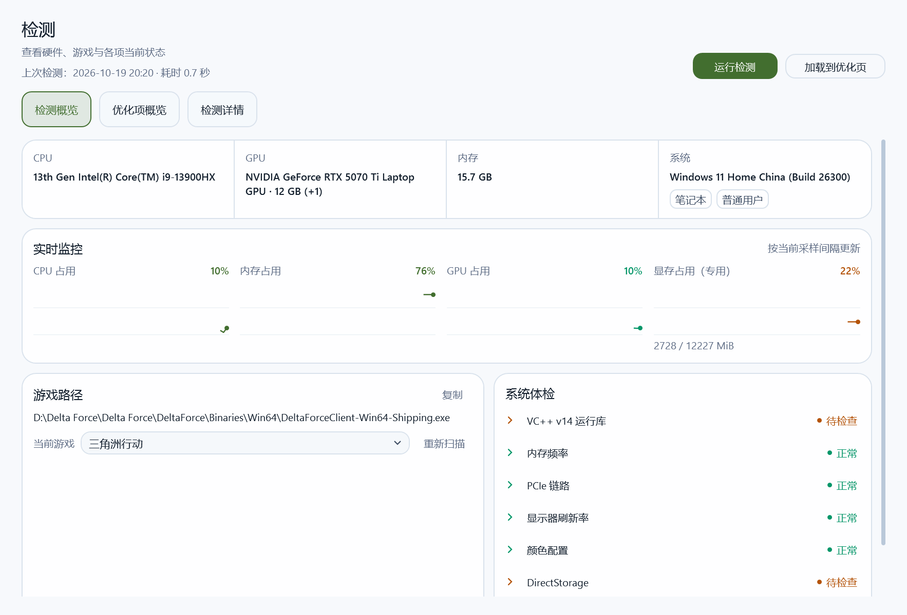
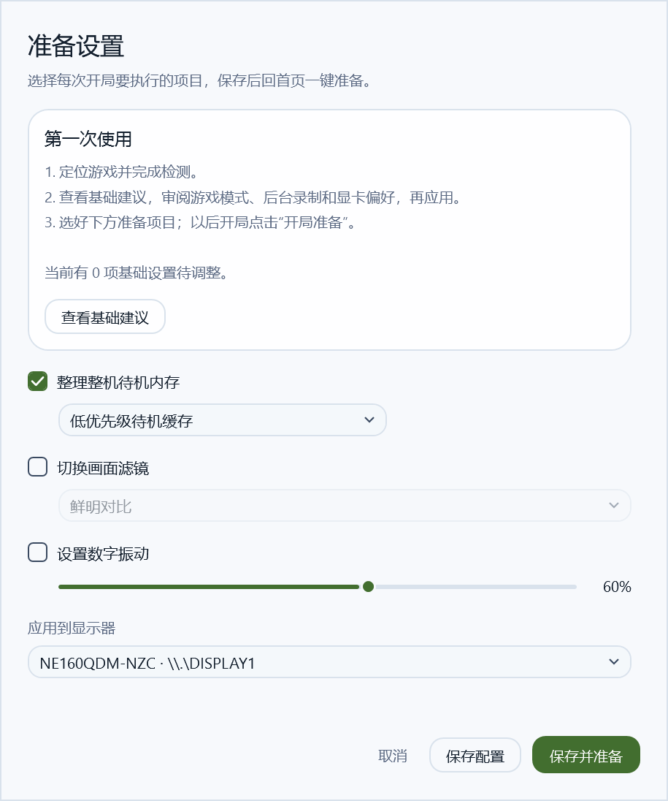

# FPS 帧律 · fps-tune

[简体中文](README.md) · [English](README.en.md) · [官方下载](https://github.com/jidekaixin2dian/fps-tune/releases/tag/v0.3.0)

面向 Windows 玩家的系统设置调校与性能测量工具：检测 → 审阅 → 应用 → 实测 → 还原。
提供桌面界面和命令行两种使用方式。

[](https://github.com/jidekaixin2dian/fps-tune/releases/tag/v0.3.0)

[](LICENSE)
[](https://github.com/jidekaixin2dian/fps-tune/actions/workflows/build.yml)
[](https://qm.qq.com/q/yIjLxOFGCG)

## 版本与下载

当前版本为 **[v0.3.0](https://github.com/jidekaixin2dian/fps-tune/releases/tag/v0.3.0)**。
1.x 版本线已停止维护。

从本仓库 [Releases](https://github.com/jidekaixin2dian/fps-tune/releases/tag/v0.3.0) 下载，适用于 Windows 10/11 x64；具体系统版本需满足 .NET 10 的运行条件。

**优先下载 [EXE 安装版：FpsTune-Setup-0.3.0.exe](https://github.com/jidekaixin2dian/fps-tune/releases/download/v0.3.0/FpsTune-Setup-0.3.0.exe)**，已包含 .NET 运行时，按向导安装即可。便携 ZIP 适合已有对应运行时、需要免安装使用的用户。

| 文件 | 用途 |
|---|---|
| `FpsTune-Setup-<版本>.exe` | **推荐优先下载**；安装包，包含 .NET 运行时 |
| `FpsTune-Portable-<版本>.zip` | 便携包，需要 [.NET 10 Windows Desktop Runtime](https://dotnet.microsoft.com/download/dotnet/10.0) |
| `SHA256SUMS-v<版本>.txt` | 使用 `Get-FileHash -Algorithm SHA256 <文件>` 校验下载文件 |

本版校验清单：[SHA256SUMS-v0.3.0.txt](https://github.com/jidekaixin2dian/fps-tune/releases/download/v0.3.0/SHA256SUMS-v0.3.0.txt)。

当前程序未做代码签名，Windows 可能提示未知发布者。运行前核对来源及校验值；校验值用于检查内容一致性，不能替代发布者签名。
便携包和安装包均包含完整 LICENSE 与第三方声明；软件「设置 → 关于 → 开源许可」和 CLI `-License` 也可查看全文。

安装版提供帧律品牌安装向导，可选择安装目录；再次安装时保留原目录作为默认值，也可自行调整。更新提示会展示主要变化，并提供官方下载页入口。

## 界面预览


| 显示与画质 | 系统检测 |
|---|---|
|  |  |

<details>
<summary>更多界面：开局准备、深色主题、优化、性能记录与维护</summary>




</details>

## 当前功能

- **工作台与紧凑控制台**：深浅主题和主题切换过渡，统一选择控件，可使用本地图片作为软件背景。低配模式或 Windows 关闭动画时直接切换主题。
- **检测与系统调校**：39 个可选项目，逐项展示当前状态、权限、重启要求和副作用。均衡预选 16 项，保守方案含 4 项；也可自定义选择。
- **开局准备**：保存整机待机内存整理、ICC 滤镜、数字振动和目标显示器的组合，开局前一键执行，分别显示各项结果。
- **游戏限帧**：按游戏设置 NVIDIA 前台、后台帧率上限，并可单独还原。
- **多游戏**：识别三角洲行动、CS2、VALORANT、APEX、PUBG、使命召唤、Fortnite、Warframe 等客户端，支持共享游戏库与手动选择 EXE。识别路径不等于已完成每款游戏的性能或反作弊兼容性验证。
- **显示与画质**：按游戏调整 NVIDIA DRS / DLSS 配置、选定显示器的数字振动、11 个生成的 ICC 预设或自选 `.icc` / `.icm`，以及逐屏原始关联还原。ICC 在使用颜色管理的应用中生效，部分游戏会忽略它。
- **更改显卡名称**：提供 GTX 750 Ti、GTX 1050 Ti 等 8 个预设，应用前预览，可还原原名称。修改 Windows 设备描述，显卡能力保持原样。
- **设置分类**：外观、壁纸、启动与通知、游戏与方案、数据与权限、关于；设置自动保存，壁纸提供圆角预览与短滑条。
- **日常维护**：查看固定磁盘空间和内存工作集前 8 项，按需刷新；打开 Windows 存储清理、已安装应用、任务管理器、启动应用、可靠性历史、资源监视器、网络和更新页面。快照保留在当前页面，不自动上传。
- **缓存维护**：先预览当前用户的 DirectX / NVIDIA 着色器缓存，再确认清理；跳过占用或预览后变化的文件。删除的缓存不能还原，下次运行会重建，可能短暂卡顿。
- **性能会话与 A/B**：本机记录 CPU、内存、GPU、显存和帧时间，支持报告导出与会话比较。真实 FPS 采样需要官方 PresentMon。
- **引导与反馈**：性能记录和 A/B 实验提供入门步骤；QQ 加群反馈与更新提醒独立显示，加群提示可选择不再提醒。
- **备份与恢复**：统一列出系统、游戏驱动配置、ICC 和数字振动的备份，保留逐项结果和失败原因。

这些功能调整系统或驱动配置，不修改游戏文件、不注入游戏进程。效果取决于硬件、驱动、游戏和场景，以同机对照测量为准。

## 快速开始

运行 `FpsTune.exe`，选择游戏并做一次检测，在优化页审阅所选项目后应用。
先测试少量项目；通过性能会话或固定场景的 A/B 判断是否保留。
需要管理员的操作会提示重启为管理员；应用以 `asInvoker` 启动，不在启动时要求管理员权限。

<details>
<summary>命令行用法（进阶使用）</summary>

```powershell
.\FpsTune.exe -Detect -Json                       # 只读检测
.\FpsTune.exe -Detect -Game "C:\Games\Game.exe" -Json
.\FpsTune.exe -Apply -Preset balanced -Json       # 应用前审阅并同意所选项目
.\FpsTune.exe -Apply -Items game-mode,gpu-pref -Game "C:\Games\Game.exe" -Json
.\FpsTune.exe -ListRestore -Json                  # 查看备份范围
.\FpsTune.exe -Restore -Json                      # 还原支持的备份
.\FpsTune.exe -Version                           # 版本与构建提交
.\FpsTune.exe -License                           # 完整许可证与第三方声明
```

目录标记 28 项需要管理员、16 项需要重启。CLI 执行 Apply / Restore 即开始操作，需在已同意的范围内使用。
AI 助手操作流程见 [SKILL.md](SKILL.md)。

</details>

## 备份与实测的边界

每次受支持的系统或驱动设置写入前保存原值，读取原值失败时停止该项写入。恢复仅处理本工具记录的目标；外部修改、设备或驱动身份变化、旧备份信息不足时，会保留备份并报告需要核对的项目。
备份导入用于保存记录，不把其他机器或重装前的备份当成本机可直接执行的恢复指令。
关闭休眠可重新启用，但删除的休眠文件内容和原文件类型、大小不属于恢复范围；缓存清理同样不属于可逆设置。

```powershell
.\FpsTune.exe -Experiment -Baseline -Json
.\FpsTune.exe -Experiment -Test -Group group-1 -Json
.\FpsTune.exe -Experiment -Report -Json
# 演练：以上每条命令都加 -Simulate，使用独立的模拟记录。
```

真实测量需自行安装官方 PresentMon（如 `winget install Intel.PresentMon.Console`）。工具检查其签名与发布者，再调用采样。
A/B 使用固定硬件、游戏、画质与路线，要求至少 3 次有效样本且 CV ≤ 0.05；P99 恶化超过 3% 时不保留。其余收益阈值见程序判定记录。
这些是规则判定，不是统计显著性证明。模拟结果独立存储，不作为真实 FPS 收益；回滚失败会报告并保留恢复记录。

## 更新与隐私

默认启动检查本仓库 GitHub Releases，可在设置中关闭，也可手动检查。
发现新版本时展示主要变化；点击「打开下载页面」前往对应版本，优先选择 EXE 安装包。更新由你决定。
无需第三方网盘。下载使用官方 HTTPS 发布资产并核验同一 Release 的 SHA256 清单。

硬件检测、游戏路径、设置备份、会话和日志保存在 `%LocalAppData%\FpsTune`，不自动上传。
更新请求会向 GitHub 提供网络连接所需的 IP 和 `FpsTune` User-Agent，不发送硬件、游戏清单或日志。GitHub 与 QQ 各自按其服务规则处理访问和社区资料。
诊断包由你手动导出，可能包含设备、设置与操作记录；分享前检查内容。移除本地记录前，先保留需要的备份。

详细版本变化见 [CHANGELOG.md](CHANGELOG.md)。

## 社区交流与反馈

欢迎加入 **FPS 帧律开发者交流群**，交流软件使用经验、反馈问题、提出功能建议，也可以讨论开发者的其他开源软件项目。

- **QQ 交流群：659528489** · [一键加群](https://qm.qq.com/q/yIjLxOFGCG)
- **问题反馈与功能建议：** [GitHub Issues](https://github.com/jidekaixin2dian/fps-tune/issues)

项目欢迎正常使用、学习和分享。转载或分发时，请遵守项目的开源许可，并尽可能注明原项目来源。

**说明：** QQ 群主要用于社区交流，不保证实时技术支持。涉及安全漏洞或隐私信息的问题，请勿直接在群内公开。

本仓库目前未启用 GitHub 私密漏洞报告。需报告敏感问题时，先发不含利用步骤和个人资料的联系请求，待维护者提供私密渠道后再提交细节。

## 许可与分发

项目自身代码使用 [MIT License](LICENSE)，保留原有 `Copyright (c) 2026 delta-force-tune contributors` 声明；项目更名没有改变历史声明。
MIT 允许使用、修改、复制、分发、再许可和商业使用，条件是保留版权与许可声明。注明项目来源是建议，不是新增的许可限制；修改版可另行命名并清楚说明其来源。
第三方组件的许可范围见 [THIRD-PARTY-NOTICES.txt](THIRD-PARTY-NOTICES.txt)，不能用本项目 MIT 替代第三方许可。

项目名称用于识别本项目，提及游戏或硬件品牌用于说明适配对象，不表示相关厂商赞助或背书。软件按 MIT 原文提供，不承诺固定帧数收益。
